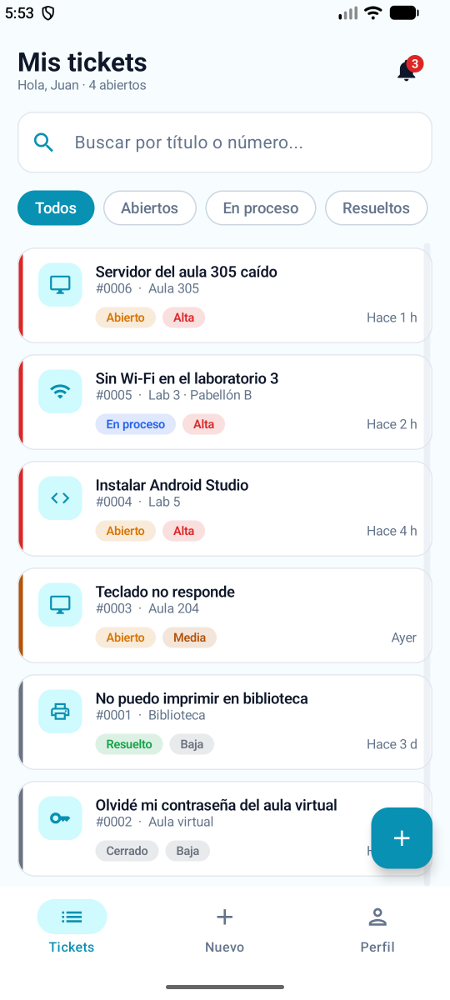
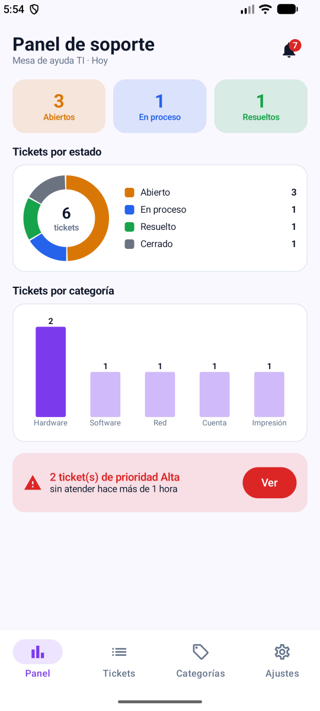
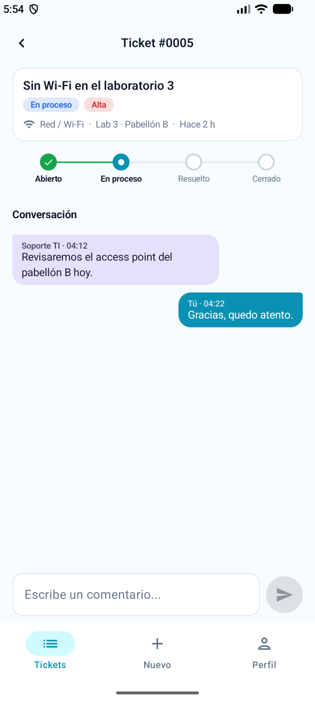
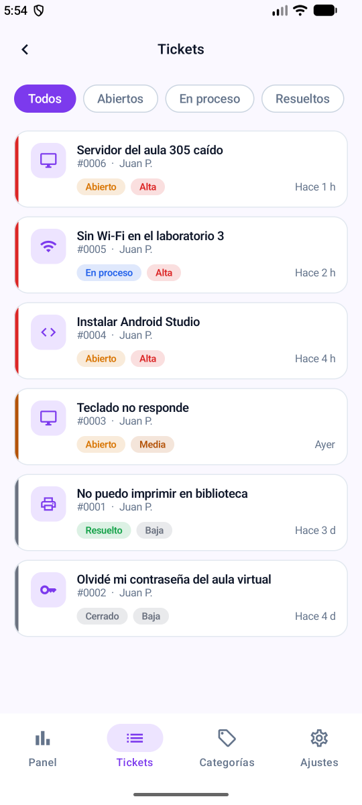
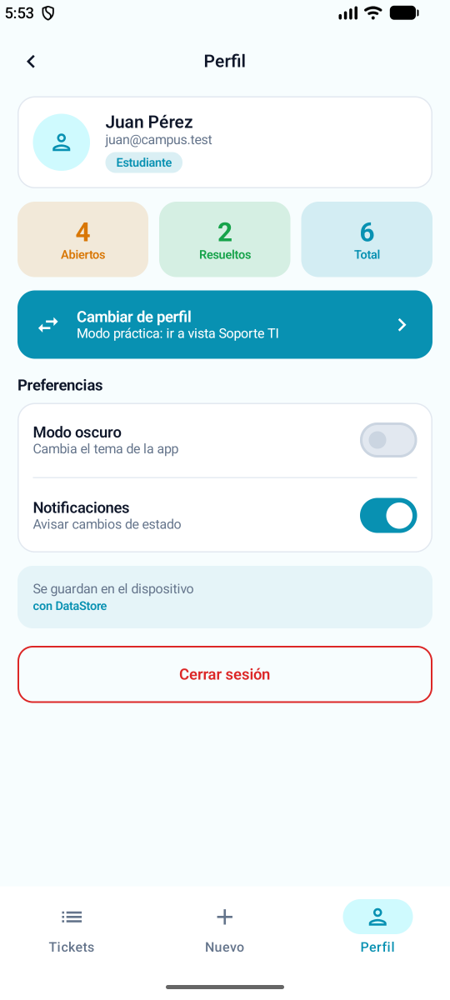
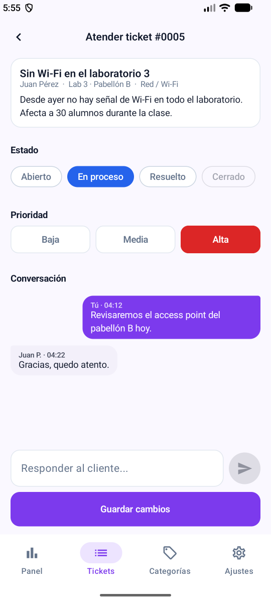

# AyudaCampus

Mesa de ayuda de TI del campus. App Android con **Kotlin + Jetpack Compose + Material 3** (sin XML), **Room**, **DataStore** y **Navigation Compose**, con el patrón **MVVM + Repository (interface)**.

Dos perfiles en el mismo dispositivo y la misma base de datos:

- **Estudiante** (`juan@campus.test` / `1234`): reporta incidencias, conversa con Soporte, califica y cierra o reabre.
- **Soporte TI** (`soporte@campus.test` / `admin`): ve el panel con gráficos, atiende la bandeja ordenada por prioridad, cambia estado y prioridad, responde y administra las categorías.

Solo datos ficticios (Ley 29733).

## Arquitectura MVVM

```
VIEW (Composable)
   │ eventos (clics)            ▲ collectAsState()
   ▼                            │
VIEWMODEL (StateFlow + reglas de negocio)
   │ llama                      ▲ Flow / resultados
   ▼                            │
AyudaRepository (interface)
   │ la implementa
   ▼
AyudaRepositoryRoom ──► DAO ──► SQLite (ayudacampus.db)

DataStore (solo preferencias) ──► ViewModel
```

Lectura que actualiza la pantalla → `Flow` (sin `suspend`). Escritura o acción única → `suspend`.

## Paquetes

```
com.tecsup.ayudacampus
├── MainActivity.kt
├── AyudaApp.kt                      crea la base, el repository y siembra los datos
├── data
│   ├── local
│   │   ├── entity      Categoria, Usuario, Ticket, Comentario
│   │   ├── dao         CategoriaDao, UsuarioDao, TicketDao
│   │   ├── relation    TicketConDetalle
│   │   ├── AyudaDatabase.kt
│   │   └── DatosIniciales.kt
│   ├── repository      AyudaRepository (interface), AyudaRepositoryRoom
│   └── prefs           PreferenciasStore (DataStore)
├── model               Rol, EstadoTicket, Prioridad, ConteoCategoria
├── viewmodel           AyudaViewModelFactory, Sesion, MisTickets, NuevoTicket,
│                       TicketDetalle, Panel, Bandeja, Atender, Categorias
└── ui
    ├── theme           Color, Type, Theme (AyudaTheme(rol, oscuro))
    ├── components      AppTopBar, AyudaButton, AyudaTextField, EstadoChip, PrioridadChip,
    │   │               TicketCard, BurbujaComentario, StepperTicket, Estrellas, Tarjetas
    │   └── graficos    DatoGrafico, GraficoDona, GraficoBarras (Canvas)
    ├── navigation      Rutas, NavAyuda
    ├── cliente         Splash, Login, Registro, MisTickets, NuevoTicket, DetalleTicket, Perfil
    └── soporte         Panel, Bandeja, AtenderTicket, Categorias, FormularioCategoria, Ajustes
```

## Base de datos (4 tablas)

| Tabla | Relación |
|---|---|
| usuarios | — |
| categorias | — |
| tickets | N tickets → 1 cliente (FK), N tickets → 1 categoría (FK) |
| comentarios | N comentarios → 1 ticket (FK con `CASCADE`) |

## Capturas

| Estudiante | Soporte TI |
|---|---|
|  |  |
|  |  |
|  |  |

## Para pensar

| Pregunta | Respuesta |
|---|---|
| ¿Por qué las reglas de estado están en el ViewModel? | El DAO solo guarda y el Composable solo dibuja; en el ViewModel las reglas no dependen de la pantalla ni de la base. |
| ¿Por qué `crearTicket` es `suspend` y `observarTicket` es `Flow`? | Crear es una acción única; observar debe avisar cada vez que el ticket cambia. |
| ¿Qué pasaría si un ticket se cerrara sin calificación? | Se perdería la opinión del estudiante y no se sabría si el problema se resolvió. |
| ¿Qué cambiaría si los tickets vivieran en un servidor? | Solo otra implementación de `AyudaRepository`; ViewModels y pantallas quedan igual. |

## Extras

- Campana con avisos (nuevos tickets, respuestas y cambios de estado) y notificaciones del sistema, según el switch "Notificaciones" de DataStore.
- Barra de scroll visible en las listas y pantallas largas.
- Registro de estudiante con validaciones (correo único) y botón de ojo para mostrar la contraseña.

## Notas de versiones

El proyecto usa AGP 9.4.1 con Kotlin 2.2.10 integrado, así que no se aplica el plugin `org.jetbrains.kotlin.android` y KSP es la versión 2.3.12 (KSP2). Room 2.6.1 falla con KSP2 (`unexpected jvm signature V`), por eso se usa **Room 2.7.2**, que tiene la misma API.
