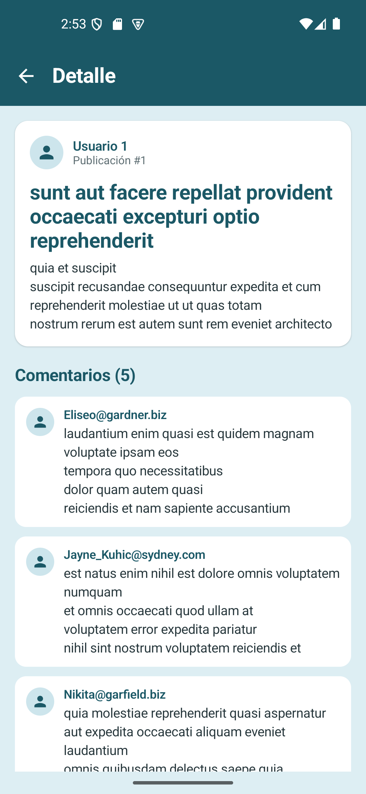
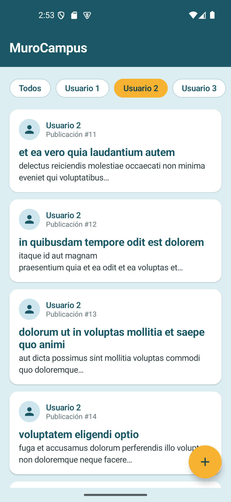
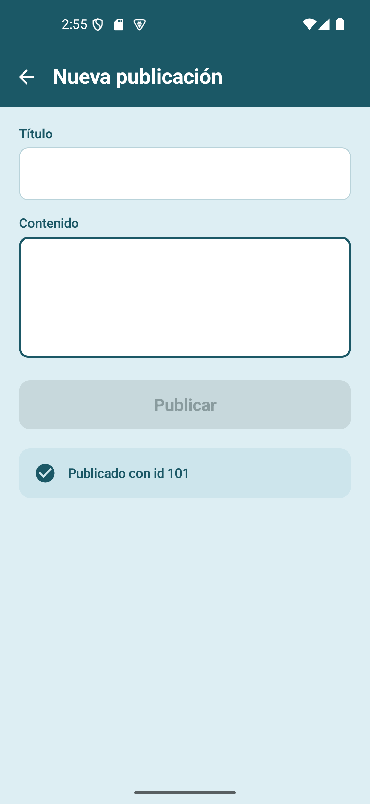
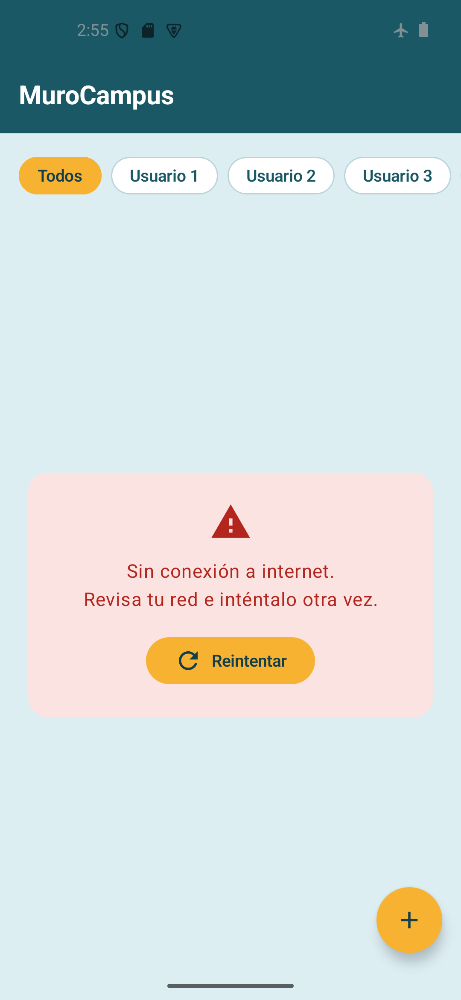
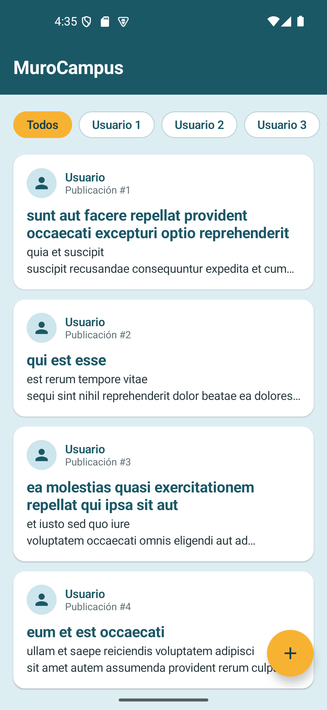
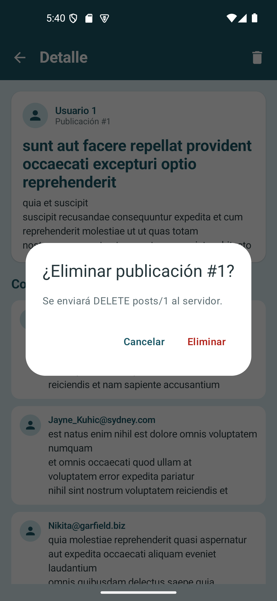
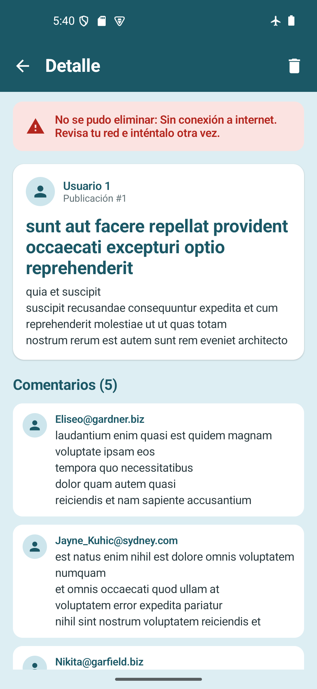
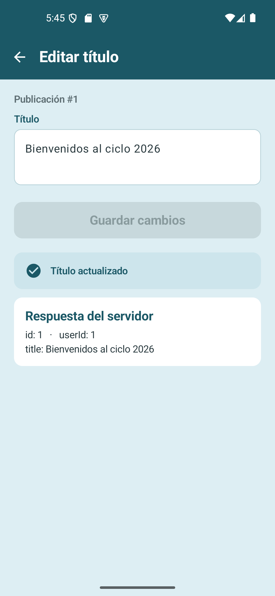
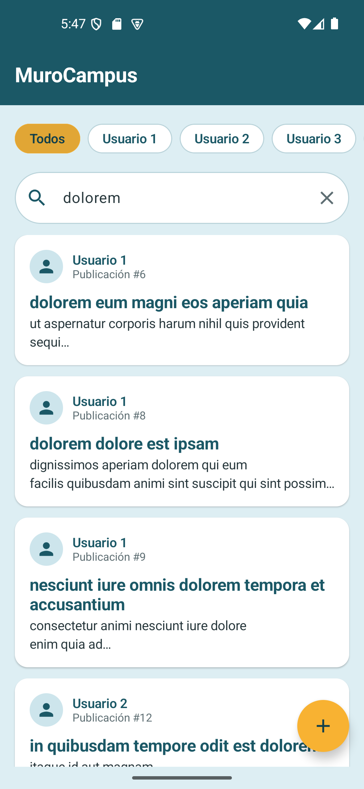

# MuroCampus

**Laboratorio 09 · Servicios Web y plataforma REST · Programación en Móviles (4.º ciclo, Tecsup)**

MuroCampus es una app Android en Jetpack Compose que consume el servicio REST de
[JSONPlaceholder](https://jsonplaceholder.typicode.com/): lista publicaciones, muestra el detalle con sus
comentarios, filtra por usuario y crea una publicación nueva. Si no hay internet o el servidor falla, la app no
se cierra: muestra el error y un botón **Reintentar**.

- **Arquitectura:** MVVM + Repository
- **Red:** Retrofit 2.11 + OkHttp 4.12 (con `HttpLoggingInterceptor`) + kotlinx.serialization
- **Estados de pantalla:** `UiState` → `Cargando`, `Exito`, `Error`
- **Diseño:** barra azul petróleo, fondo celeste, tarjetas blancas y acento naranja (chip activo, FAB y botón Publicar)

## Estructura de paquetes

```
com.tecsup.murocampus/
├── MainActivity.kt                 navegación simple (lista / detalle / crear) y BackHandler
├── model/
│   └── Modelos.kt                  Usuario, Post, Comentario, NuevoPost (@Serializable)
├── data/
│   ├── remote/
│   │   ├── PostApi.kt              interface Retrofit: @GET, @Path, @Query, @POST, @Body
│   │   ├── UsuarioApi.kt           ejemplo resuelto
│   │   └── RetrofitClient.kt       object con baseUrl, OkHttp + logging y conversor JSON
│   ├── PostRepository.kt           interface + PostRepositoryRemote (devuelve Result)
│   ├── ErrorApp.kt                 traduce IOException / HttpException / SerializationException a errores propios
│   ├── ProveedorRepositorio.kt     arma PostRepositoryRemote(RetrofitClient.api)
│   └── UsuarioRepository.kt        ejemplo resuelto
├── viewmodel/
│   ├── UiState.kt                  Cargando / Exito / Error + mensajeDe(ErrorApp)
│   ├── PostsViewModel.kt           lista, filtro, detalle y crear
│   └── PostsViewModelFactory.kt    usa ProveedorRepositorio (no importa Retrofit)
└── ui/
    ├── Componentes.kt              TarjetaPost, Cargando, ErrorConReintento, Avatar
    ├── PantallaLista.kt            chips de filtro + LazyColumn + FAB
    ├── PantallaDetalle.kt          publicación completa + Comentarios (N)
    ├── PantallaCrear.kt            formulario Título / Contenido + Publicar
    ├── PantallaEditar.kt           Fase 2: cambia el título con PATCH
    └── theme/                      Color.kt y Theme.kt
```

## Diagrama MVVM

```
View (PantallaLista, PantallaDetalle, PantallaCrear)
   │ eventos: cargar, filtrar, abrir, publicar        ▲ collectAsStateWithLifecycle()
   ▼                                                   │
ViewModel (PostsViewModel) ── StateFlow<UiState> (Cargando / Exito / Error) ──┘
   │ viewModelScope.launch
   ▼
PostRepository (interface)  ← devuelve Result<...>; si falla, Result.failure(ErrorApp)
   └─ PostRepositoryRemote  (captura IOException, HttpException, SerializationException y las traduce a ErrorApp)
         │
         ▼
PostApi (Retrofit) ── OkHttp ──► https://jsonplaceholder.typicode.com/
```

| Capa | Conoce a | No debe |
|---|---|---|
| View (`ui/`) | Solo a su ViewModel | Llamar a la API desde un Composable |
| ViewModel | Solo a la interface `PostRepository` | Conocer Retrofit, `PostApi`, `HttpException` ni `Context` |
| Repository | `PostApi` y las excepciones de red (las traduce a `ErrorApp`) | Conocer la UI ni dejar escapar excepciones |
| `data/remote` | Retrofit, OkHttp y el JSON | Guardar estado de pantalla |

## Endpoints usados

| Para | Verbo y ruta | Función en `PostApi` |
|---|---|---|
| Listar publicaciones | `GET posts` | `listar()` |
| Ver una publicación | `GET posts/{id}` | `detalle(@Path id)` |
| Ver sus comentarios | `GET posts/{id}/comments` | `comentarios(@Path id)` |
| Filtrar por usuario | `GET posts?userId=2` | `porUsuario(@Query userId)` |
| Crear una publicación | `POST posts` + JSON | `crear(@Body nuevo)` |
| Borrar una publicación (Fase 2) | `DELETE posts/{id}` | `eliminar(@Path id): Response<Unit>` |
| Cambiar el título (Fase 2) | `PATCH posts/{id}` + `{"title": …}` | `editarTitulo(@Path id, @Body cambio)` |

## Capturas

| Lista | Detalle | Filtro (Usuario 2) |
|---|---|---|
|  |  |  |

| Crear | Error de conexión | Prueba JSON: `Post` sin `userId` |
|---|---|---|
|  |  |  |

## Pruebas de error (Paso 10)

| Prueba | Cómo provocarla | Resultado esperado | OK |
|---|---|---|---|
| Sin internet | Modo avión y abrir la app | "Sin conexión a internet" y botón Reintentar | ✅ |
| Reintentar | Quitar modo avión y pulsar Reintentar | Carga la lista | ✅ |
| Recurso inexistente | `posts/9999` en detalle (temporal) | "Error del servidor (404)" | ✅ |
| JSON inesperado (quitar) | Quitar de `Post` el campo `userId`, que sí llega (temporal; la tarjeta muestra solo "Usuario") | La lista carga igual: el JSON trae `userId` de más y `ignoreUnknownKeys` lo ignora | ✅ |
| JSON inesperado (agregar) | Agregar a `Post` un campo que no llega (`autor`, temporal) | "Respuesta inesperada" | ✅ |
| Cancelación | Abrir el detalle y volver rápido | Sin errores en Logcat | ✅ |
| Lista y detalle | Abrir varias publicaciones | Siempre 5 comentarios | ✅ |
| Filtro | Elegir cada usuario | Siempre 10 publicaciones | ✅ |
| Crear | Enviar una publicación | "Publicado con id 101" | ✅ |
| Código | Revisar toda la carpeta `viewmodel/` (`grep -ri "retrofit\|HttpException\|PostApi" viewmodel/`) | Sin coincidencias: `HttpException` se traduce en `data/ErrorApp.kt` | ✅ |

## Fase 2 · Mejoras con IA (rama `mejora-ia-semana09`)

| Mejora | Qué hace | Capas que cambian |
|---|---|---|
| Borrar publicación | Papelera en el detalle, diálogo de confirmación y `DELETE posts/{id}`. El Repository revisa el código con `Response<Unit>` y, si no es 2xx, lanza `HttpException`, que se traduce a `ErrorApp` | API + Repository + ViewModel + View |
| Editar título | Lápiz en el detalle abre **Editar título**, que envía `PATCH posts/{id}` solo con el título y muestra la respuesta del servidor. El detalle y la lista se actualizan con esa respuesta | Modelo + API + Repository + ViewModel + View |
| Búsqueda | Campo "Buscar por título" debajo de los chips. Filtra lo ya descargado (sin pedir nada a la red) y se combina con el filtro por usuario | ViewModel + View |

JSONPlaceholder no guarda cambios: el DELETE y el PATCH responden 200, pero al recargar vuelven los datos originales.
Por eso el ViewModel aplica el resultado sobre la lista ya descargada.

| Eliminar | Error al eliminar | Editar título | Búsqueda |
|---|---|---|---|
|  |  |  |  |

Los prompts usados, lo que respondió la IA y lo que se corrigió están en [PROMPTS.md](PROMPTS.md).

## Para pensar

**1. ¿Qué diferencia hay entre GET y POST? ¿Por qué crear lleva `@Body` y porUsuario lleva `@Query`?**
GET solo **lee** un recurso y no cambia nada en el servidor; POST **crea** un recurso nuevo y envía datos.
`crear` necesita mandar un objeto completo (título, texto, usuario), así que va como JSON en el cuerpo de la
petición con `@Body`. `porUsuario` no envía datos, solo filtra lo que lee: el filtro viaja en la URL como
parámetro (`posts?userId=2`) y para eso se usa `@Query`.

**2. ¿Por qué la ruta es `"posts"` y no `"/posts"`?**
Retrofit combina la ruta con la URL base. Una ruta relativa (`posts`) se **suma** al final de la base
(`https://jsonplaceholder.typicode.com/` + `posts`). Si empieza con `/`, se toma como ruta absoluta desde la raíz
del dominio y **reemplaza** el camino que tuviera la base (por ejemplo, `.../api/v1/` perdería `api/v1`). Por eso
la base termina en `/` y las rutas no empiezan con `/`.

**3. ¿Por qué el Repository devuelve `Result` en vez de dejar que la excepción llegue al ViewModel?**
Porque así el ViewModel no necesita conocer las excepciones de Retrofit (`HttpException`) ni de la red: recibe un
valor que es éxito o fallo y lo convierte en `UiState`. El error queda tipado en la firma, no se puede olvidar
manejarlo y la app no se cierra por una excepción no capturada. Además se puede cambiar la fuente de datos (Room,
otro servidor, un fake para pruebas) sin tocar el ViewModel ni la pantalla. La única excepción que se relanza es
`CancellationException`, para no romper la cancelación de corrutinas.

**4. ¿Qué pasa si olvidas el permiso INTERNET? ¿Y si olvidas `ignoreUnknownKeys` y el servidor agrega un campo nuevo?**
Sin el permiso la app compila y abre, pero toda llamada falla con una excepción de red (`SecurityException` /
`UnknownHostException`) y siempre se ve "Sin conexión a internet", aunque haya red. Sin `ignoreUnknownKeys`,
kotlinx.serialization es estricto: si el JSON trae un campo que la `data class` no tiene, lanza
`SerializationException` y la app muestra "Respuesta inesperada" en todas las pantallas, aunque los datos que
usamos sigan llegando bien.

**5. ¿Por qué la pantalla de lista usa un `when` sobre `UiState` y no un `if` con tres variables?**
Con tres variables (`cargando`, `error`, `datos`) se pueden dar combinaciones imposibles (cargando y error a la
vez, datos viejos con error...). Un `sealed interface` garantiza que la pantalla está en **un solo** estado a la
vez, y el `when` es exhaustivo: el compilador obliga a dibujar los tres casos. Además, en `Exito` los datos ya
vienen sin nulos (`e.datos`), así que no hay `!!` ni comprobaciones extra.

**6. JSONPlaceholder no guarda los POST. ¿Cómo cambiaría tu app si usaras un servicio real?**
Después de publicar habría que **actualizar la lista**: volver a llamar a `cargar()` o agregar el `Post` devuelto
al inicio de la lista en el ViewModel. El id sería real (no siempre 101), así que se podría abrir su detalle.
También habría que enviar autenticación (token en un encabezado con un `Interceptor`), validar los errores 400/401
que devuelva el servidor, usar `userId` del usuario que inició sesión en lugar de `1` fijo y, si se quiere
funcionar sin internet, guardar un caché local en Room con el Repository decidiendo la fuente.
