# NEXIO · Laboratorio 11-12

App Android de consulta de celulares hecha con Kotlin, Jetpack Compose + Material 3, MVVM, Retrofit, Room y Firebase Authentication + Firestore.

| Dato | Valor                                            |
|---|--------------------------------------------------|
| Curso | Programación en Móviles · 4.º ciclo · Tecsup     |
| Grupo | G01                                              |
| Integrante | Yajaira Cerron (trabajo individual) |
| Tema | Productos                                        |
| Variante | Categoría **smartphones**                        |
| API | [DummyJSON](https://dummyjson.com/docs/products) |
| Lista | `GET /products/category/smartphones`             |
| Detalle | `GET /products/{id}`                             |
| Paquete / applicationId | `com.tecsup.catalogo`                            |
| Fases | Fase 1 (sin IA): rama `semana12` · Fase 2 (con IA): rama `mejora-ia-semana12` |

## Cómo compilar

1. Abrir esta carpeta en Android Studio con JDK 17 o 21 y el SDK de Android 36 instalado (minSdk 26, targetSdk 35).
2. Poner tu propio `google-services.json` dentro de `app/` (ver la sección de Firebase). Este archivo no se sube al repositorio.
3. Sincronizar Gradle y ejecutar **app** en un emulador con Google Play o en un teléfono con Android 8.0 o superior.
4. Compilar desde cero:
   - Windows: `gradlew.bat clean assembleDebug lintDebug`
   - macOS/Linux: `./gradlew clean assembleDebug lintDebug`
5. El APK de depuración queda en `app/build/outputs/apk/debug/app-debug.apk`.

Versiones: Gradle 8.11.1, Android Gradle Plugin 8.10.1, Kotlin 2.1.10 y KSP 2.1.10-1.0.31.

| Librería | Versión |
|---|---|
| Retrofit + `converter-kotlinx-serialization` | 2.11.0 |
| kotlinx-serialization-json | 1.7.3 |
| OkHttp + logging-interceptor | 4.12.0 |
| Room (runtime, ktx, compiler con KSP) | 2.8.5 |
| Lifecycle (viewmodel-compose, runtime-compose) | 2.8.7 |
| Navigation Compose | 2.8.4 |
| Firebase BoM (auth, firestore) | 33.5.1 |
| kotlinx-coroutines-play-services | 1.9.0 |
| Coil (imágenes) | 2.7.0 |

En el Manifest están los permisos `INTERNET` y `POST_NOTIFICATIONS`. La `baseUrl` de Retrofit termina en `/`.

## Cómo configurar Firebase y crear los usuarios de prueba

1. En la [consola de Firebase](https://console.firebase.google.com/), crear un proyecto y registrar la app Android con el paquete exacto `com.tecsup.catalogo`. Descargar `google-services.json` y ponerlo en `app/`.
2. **Authentication → Método de acceso:** activar *Correo electrónico/contraseña*.
3. **Authentication → Usuarios:** crear dos usuarios. En este proyecto se usaron `admin@nexio.com` y `usuario@nexio.com`. Las contraseñas se ponen en la consola y no están en el código ni en este README.
4. **Firestore Database:** crear la base de datos `(default)`.
5. Crear la colección `usuarios` con un documento por usuario. **El ID del documento es el UID** que aparece en Authentication → Usuarios:

   | ID del documento | `rol` (texto) | `nombre` (texto) |
   |---|---|---|
   | UID del administrador | `admin` | Administrador |
   | UID del usuario | `usuario` | Usuario |

6. **Firestore → Reglas:** pegar y publicar el contenido de [firestore.rules](firestore.rules). Cada persona solo puede leer su propio documento y nadie puede escribir roles desde la app.

El rol no se decide en la app: se lee de Firestore después de ingresar. Si el documento no existe o el rol no es `admin` ni `usuario`, la app no deja entrar. Ocultar pantallas en la app solo cambia lo que se ve; lo que protege los datos son las reglas de Firestore.

## Qué hace la app

| Función | Usuario | Admin |
|---|:---:|:---:|
| Ingresar con correo y contraseña | Sí | Sí |
| Ver lista y detalle | Sí | Sí |
| Marcar favoritos y ver Favoritos | Sí | Sí |
| Cerrar sesión (pestaña Perfil) | Sí | Sí |
| Panel Admin: totales, Sincronizar y Limpiar caché | No | Sí |

- **Lista:** se ve Cargando, después el catálogo. Si falla y no hay nada guardado, aparece el error con **Reintentar**. Si no hay productos, se muestra un mensaje de lista vacía.
- **Detalle:** al tocar un producto se consulta el segundo endpoint (`/products/{id}`).
- **Favoritos:** se marcan con el corazón. Se conservan al cerrar la app y al sincronizar.
- **Sin internet:** se muestran los datos guardados con el aviso «Sin conexión: mostrando datos guardados».
- **Notificación:** al terminar de sincronizar aparece «Se guardaron N elementos». Al tocarla se abre la app. Si se niega el permiso, la app funciona igual pero sin avisos.
- **Panel Admin:** total guardado, total de favoritos, **Sincronizar** y **Limpiar caché** (pide confirmación). Limpiar caché borra los productos y favoritos del celular, no las cuentas de Firebase.
- **Sesión:** se mantiene al reabrir la app hasta que se pulsa **Cerrar sesión**.

## Capturas

<table>
  <tr>
    <td align="center"><b>Login</b> 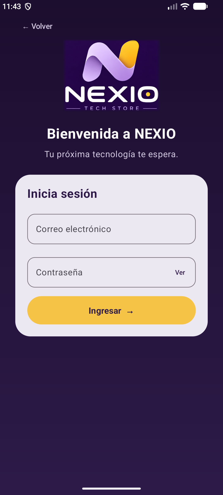</td>
    <td align="center"><b>Lista (usuario)</b> 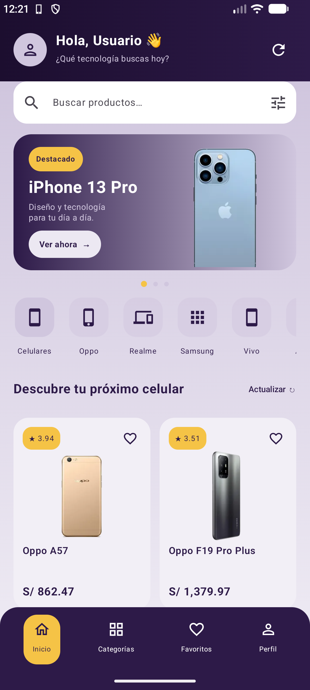</td>
    <td align="center"><b>Lista (admin)</b> 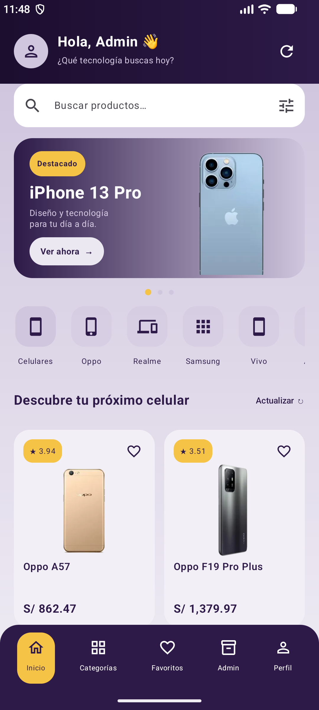</td>
  </tr>
  <tr>
    <td align="center"><b>Detalle</b> 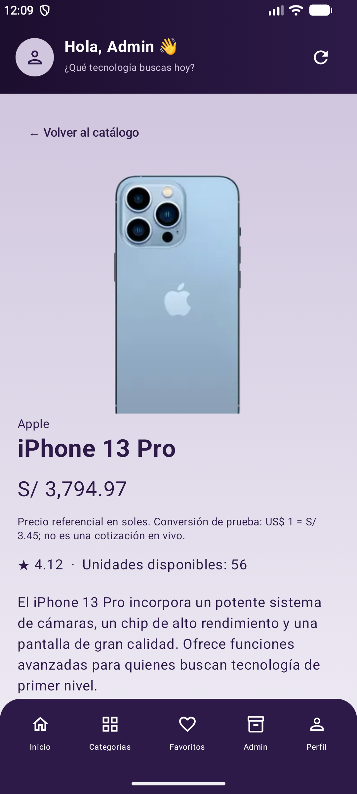</td>
    <td align="center"><b>Favoritos</b> 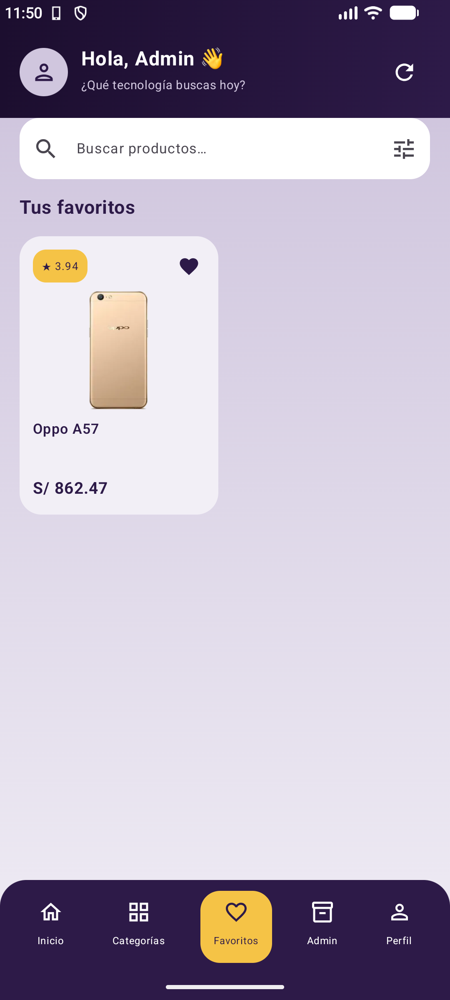</td>
    <td align="center"><b>Panel Admin</b> 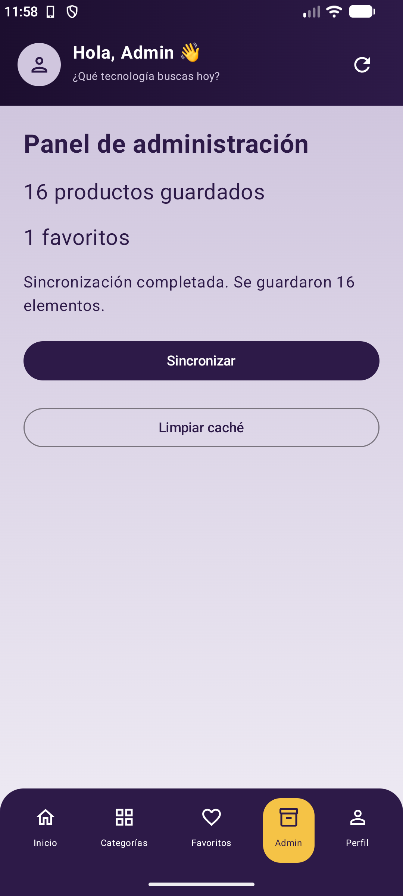</td>
  </tr>
  <tr>
    <td align="center"><b>Notificación</b> 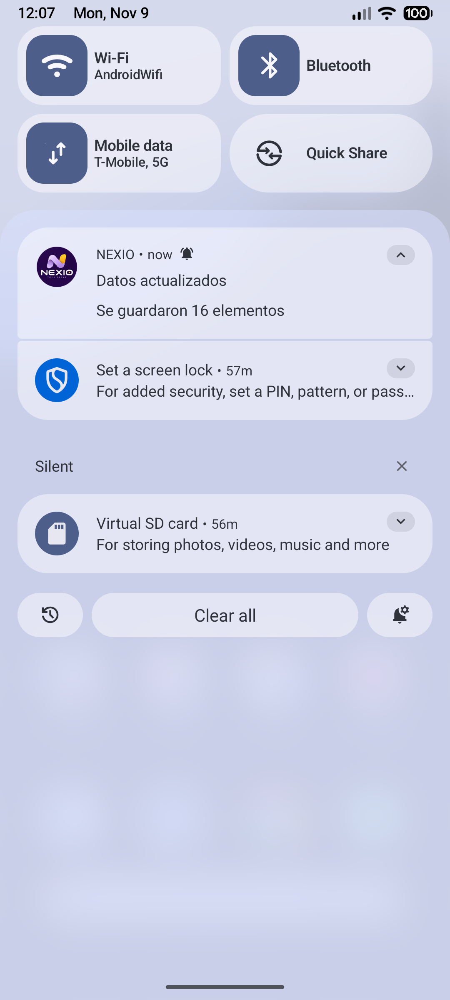</td>
    <td align="center"><b>Campos vacíos</b> 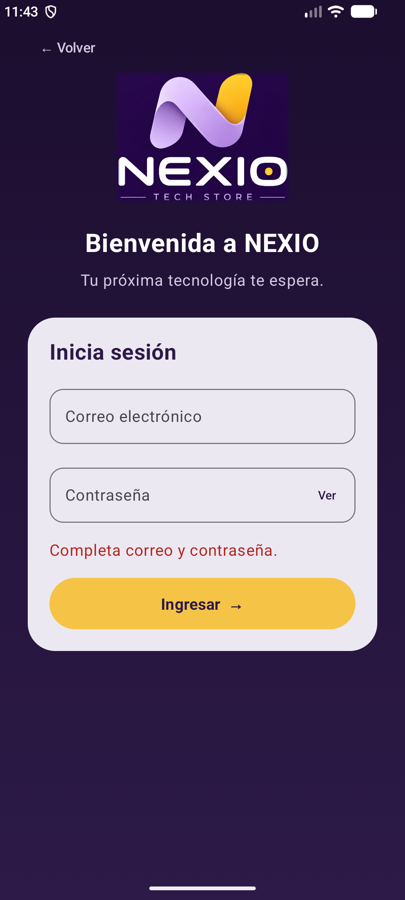</td>
    <td align="center"><b>Clave incorrecta</b> 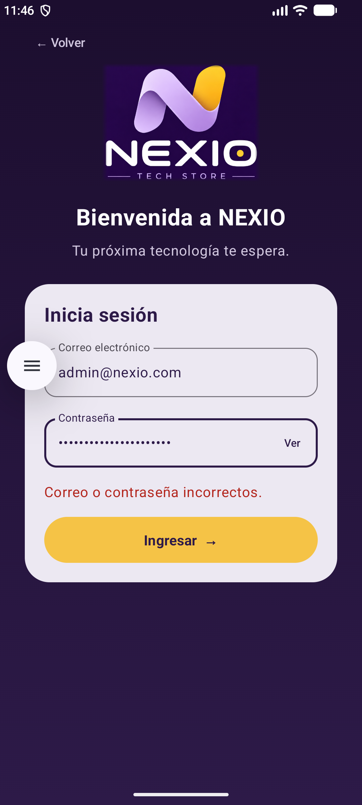</td>
  </tr>
  <tr>
    <td align="center"><b>Sin conexión, con datos</b> 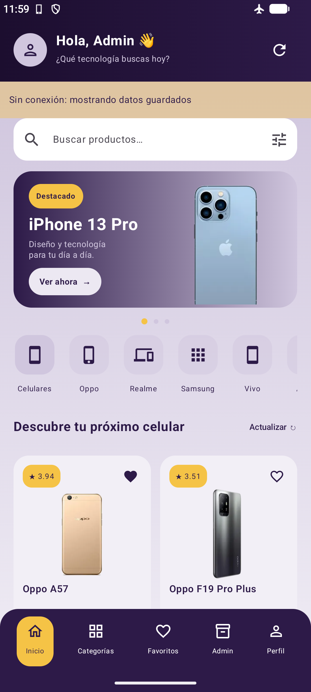</td>
    <td align="center"><b>Sin conexión, sin datos</b> 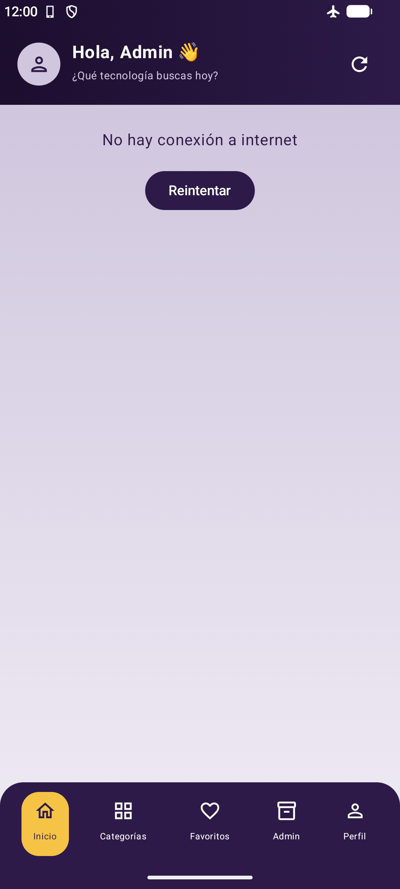</td>
    <td align="center"><b>Caché limpia</b> 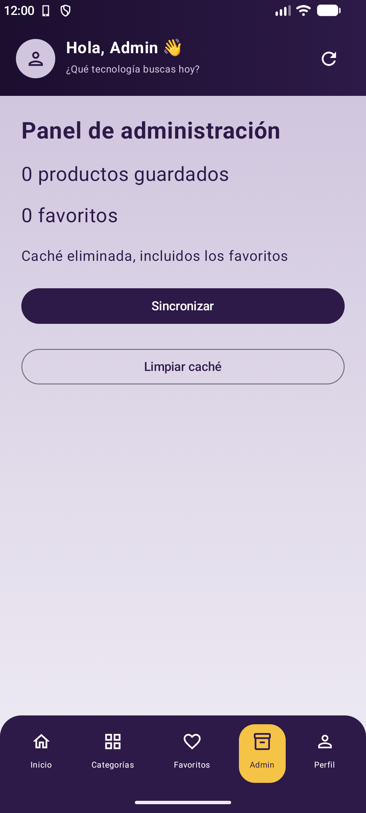</td>
  </tr>
  <tr>
    <td align="center"><b>Favorito al reabrir</b> </td>
    <td align="center"><b>Datos recuperados</b> </td>
    <td align="center"><b>Sesión cerrada</b> 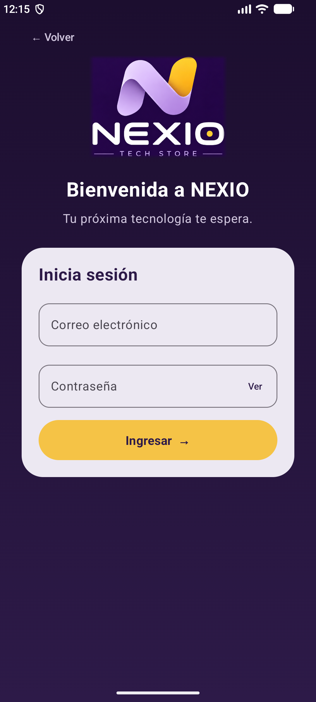</td>
  </tr>
</table>

<b>Pantalla girada</b> 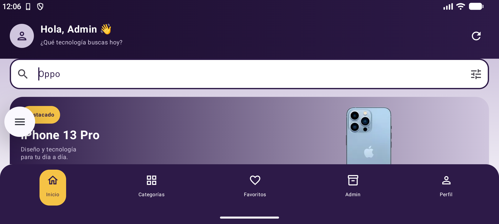

Todas las capturas están en [docs/capturas](docs/capturas).

## Arquitectura (MVVM)

- Las pantallas solo observan el estado con `collectAsStateWithLifecycle()` y llaman funciones del ViewModel. Ningún composable usa Retrofit, Room ni Firebase.
- Cada ViewModel expone un `StateFlow<UiState<T>>` (`Cargando`, `Exito`, `Error`) y no recibe `Context`.
- `ItemRepository`, `AuthRepository` y `Notificador` son interfaces. Los ViewModel dependen de ellas, nunca de la clase concreta.
- Hay tres modelos: `ItemDto` (API), `ItemEntity` (Room) e `Item` (UI), y los mappers los convierten.
- **Room es la fuente única de verdad:** la lista sale siempre de Room y Retrofit solo la actualiza. Al sincronizar se leen primero los ids favoritos y se vuelven a aplicar, así no se pierden.
- Los ViewModel se crean con un `ViewModelProvider.Factory` que recibe el `AppContainer`.

Más detalle en [docs/ARQUITECTURA.md](docs/ARQUITECTURA.md).

| Requisito | Dónde está |
|---|---|
| R01 Login y validación | `ui/login/LoginViewModel.kt`, `data/auth/FirebaseAuthRepository.kt` |
| R02 Dos roles desde Firestore | `FirebaseAuthRepository.leerSesion`, `ui/navigation/AppNav.kt` |
| R03 Lista con Cargando / Error / Vacío | `ui/lista/ListaViewModel.kt`, `ui/lista/ListaScreen.kt` |
| R04 Detalle con segundo endpoint | `data/remote/ApiService.kt`, `ui/detalle/` |
| R05 MVVM con UiState y Repository como interface | `ui/UiState.kt`, `data/repository/` |
| R06 Room | `data/local/` |
| R07 Favoritos | `ItemRepositoryImpl.refrescar`, `ui/favoritos/` |
| R08 Modo sin conexión | `ListaViewModel.refrescar` |
| R09 Notificación local | `notification/` |
| R10 Panel Admin | `ui/admin/` |
| R11 Sesión y cierre | `AuthRepository.sesionActual`, pestaña Perfil |

## Extras que no pide la guía

No cambian los contratos ni las reglas MVVM.

- **Pantalla de bienvenida** con el logo de NEXIO antes del login (`ui/login/WelcomeScreen.kt`). Solo guarda en `SharedPreferences` si ya se pasó la bienvenida; nunca guarda contraseñas.
- **Buscador y filtro por marca** en la lista y en la pestaña Categorías.
- **Precios en soles:** la API y Room guardan el precio en dólares. Solo al mostrarlo se convierte con una tasa fija de prueba (US$ 1 = S/ 3.45), que no es una cotización real. Usa `BigDecimal` con redondeo a 2 decimales (`domain/model/Moneda.kt`).
- **Descripciones en español:** las 16 descripciones de smartphones están traducidas en la app y funcionan sin internet (`data/mapper/DescripcionesEspanol.kt`). El DTO y la Entity guardan el texto original. Un producto nuevo muestra un aviso de que su traducción no está disponible, sin inventar características.
- **Confirmación** antes de limpiar la caché.
- **Pruebas instrumentadas** (`app/src/androidTest`): 15 pruebas con Room en memoria y una API falsa.

## Validación

- Compila desde cero (`clean assembleDebug assembleDebugAndroidTest lintDebug`): **BUILD SUCCESSFUL**.
- Android Lint: **0 errores**, 14 advertencias (versiones más nuevas de librerías y targetSdk).
- Pruebas unitarias de `ListaViewModel` (Fase 2, R12): **7 de 7 aprobadas**.
- Pruebas instrumentadas: **15 de 15 aprobadas** en el emulador.
- Pruebas de aceptación PA-01 a PA-14 de la guía: aprobadas. Detalle y capturas de cada caso en [docs/PRUEBAS_ACEPTACION.md](docs/PRUEBAS_ACEPTACION.md).

Para correr las pruebas unitarias (no necesitan emulador): `gradlew.bat testDebugUnitTest`.

Para correr las pruebas instrumentadas en un emulador: `gradlew.bat connectedDebugAndroidTest`.

Si el emulador falla, ver [docs/EMULADOR.md](docs/EMULADOR.md). Preguntas de la sustentación: [docs/SUSTENTACION.md](docs/SUSTENTACION.md).

## Fase 2: mejora con IA (rama `mejora-ia-semana12`)

Herramienta: Claude Code (Claude Opus 5.5). Cada consulta está registrada en [PROMPTS.md](PROMPTS.md).

| Mejora | Qué cambió | Archivos |
|---|---|---|
| **R12: pruebas unitarias** | 7 pruebas de `ListaViewModel` con un repositorio falso y un notificador falso: Cargando al abrir, lista con notificación, error sin internet, datos guardados con aviso, error HTTP, Reintentar y favoritos. | `app/src/test/.../ui/lista/` |
| **Mensajes de error** | Una sola función, `mensajeDeError`, para la lista y el detalle. El detalle ya no dice "Revisa tu conexión" cuando el error es del servidor. Un 404 muestra "No se encontró el elemento solicitado". | `ui/MensajesError.kt`, `ListaViewModel.kt`, `DetalleViewModel.kt` |
| **Interfaz** | Favoritos vacío explica qué hacer: «Aún no tienes favoritos. Toca el corazón ♡ de un producto para guardarlo aquí.» | `ListaScreen.kt`, `FavoritosScreen.kt` |

Las pruebas usan `kotlinx-coroutines-test` (`StandardTestDispatcher` + `Dispatchers.setMain`), porque `viewModelScope` corre en `Dispatchers.Main` y en una prueba de JVM no existe.

<b>Favoritos vacío (Fase 2)</b> 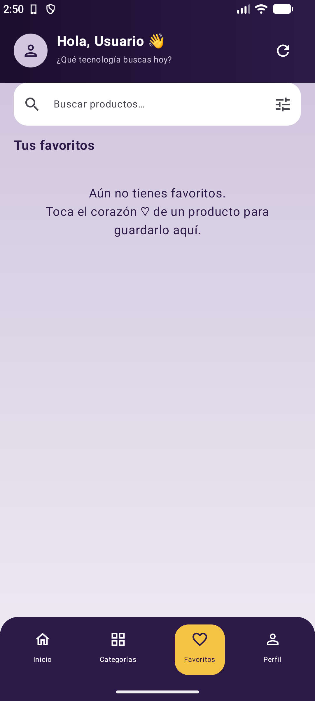

## Reparto de tareas

Trabajo individual: la única integrante hizo todas las tareas.

| Tarea | Responsable      |
|---|------------------|
| Proyecto base, estructura MVVM y contratos | _Yajaira Cerron_ |
| Retrofit: lista y detalle | _Yajaira Cerron_ |
| Room, favoritos y modo sin conexión | _Yajaira Cerron_ |
| Firebase: login, roles y sesión | _Yajaira Cerron_ |
| Panel Admin y notificación local | _Yajaira Cerron_ |
| Pruebas, capturas y README | _Yajaira Cerron_ |

## Git

- Rama `semana12`: Fase 1 (sin IA), 17 commits por hito (H1–H16 y pruebas).
- Rama `mejora-ia-semana12`: Fase 2 (con IA), con Pull Request hacia `semana12`.
- Mensajes de commit con el formato `tipo: qué se hizo` (`feat`, `fix`, `refactor`, `test`, `docs`, `chore`).
- No se suben `build/`, `.idea/`, `local.properties` ni `google-services.json` (ver [.gitignore](.gitignore)).
