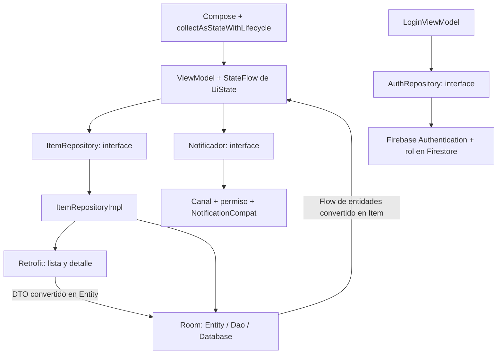

# Arquitectura MVVM

## Ubicación de las clases
| Carpeta | Responsabilidad |
|---|---|
| domain/model | Item, Sesion, Rol y formato/conversión de moneda. |
| data/remote | ApiService, RetrofitClient y DTO. |
| data/local | ItemEntity, ItemDao y AppDatabase. |
| data/mapper | Conversión de datos y descripciones en español disponibles offline. |
| data/repository | Contrato ItemRepository e implementación que coordina Retrofit y Room. |
| data/auth | Contrato de acceso y lectura de sesión/rol mediante Firebase. |
| notification | Contrato y adaptación de notificaciones Android. |
| ui | Pantallas, ViewModels, estados, navegación y tema. |
| AppContainer | Construye dependencias y Factory de ViewModels. |
| NexioApplication | Conserva un AppContainer durante la vida del proceso. |

El ViewModel no recibe Context. Los composables no consultan directamente Retrofit, Room ni Firebase. La petición del permiso de Android vive en la navegación; MainActivity pasa la respuesta a NotificadorAndroid. Los ViewModel solo conocen la interface Notificador, que tiene un único método: mostrar(titulo, texto).

## Endpoints
- Lista: GET https://dummyjson.com/products/category/smartphones
- Detalle: GET https://dummyjson.com/products/{id}

Firebase se usa para acceso y roles, no para alojar el catálogo. Las cuentas se crean en consola; esta fase no incluye registro de clientes, compras, carrito ni pagos.
