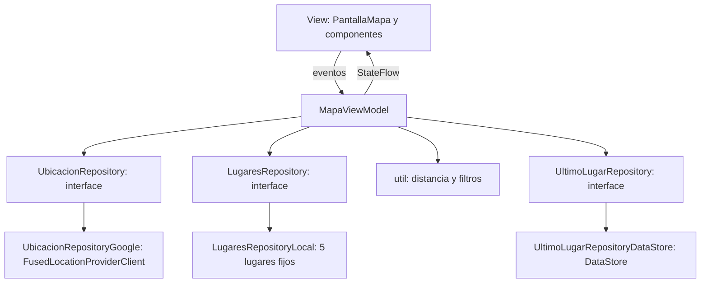
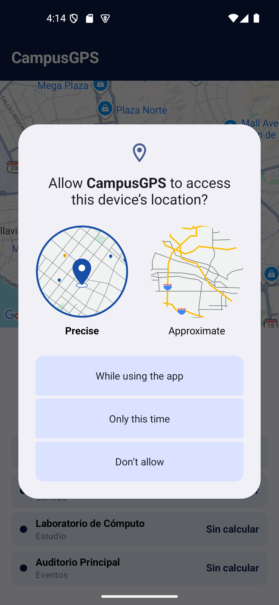
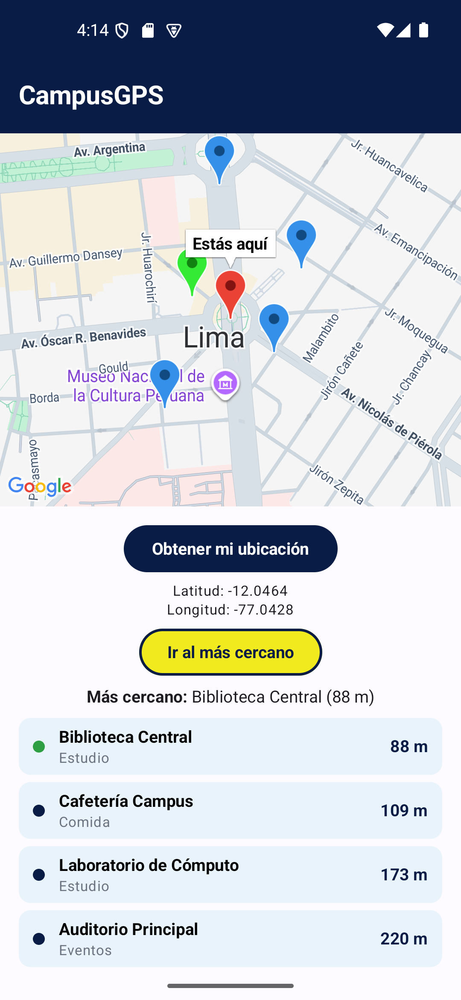
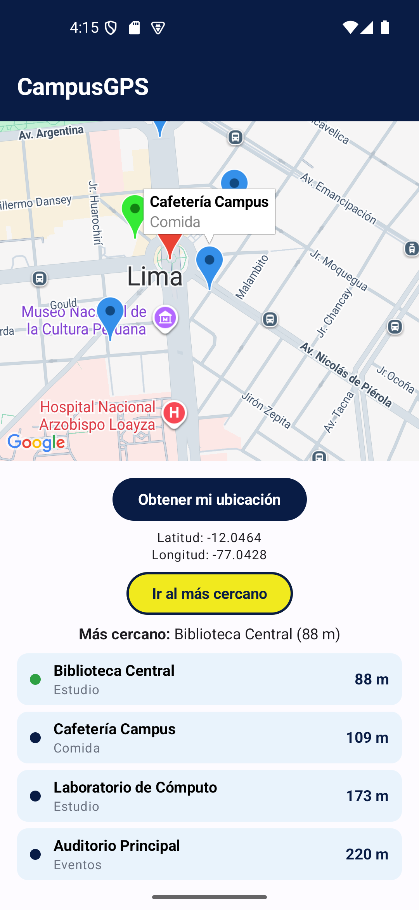
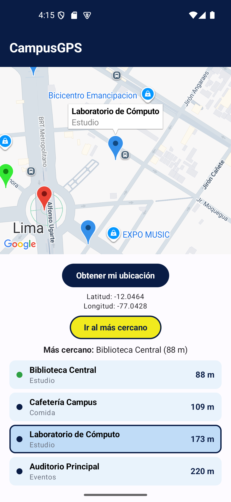
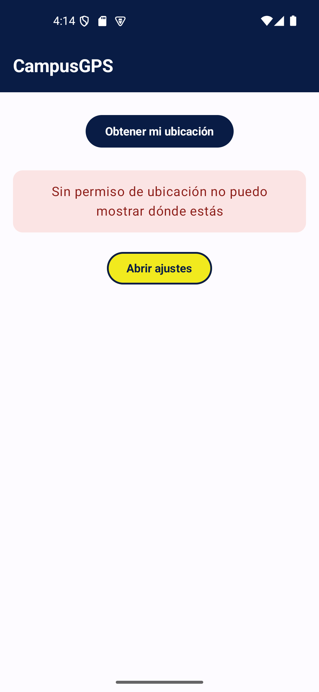
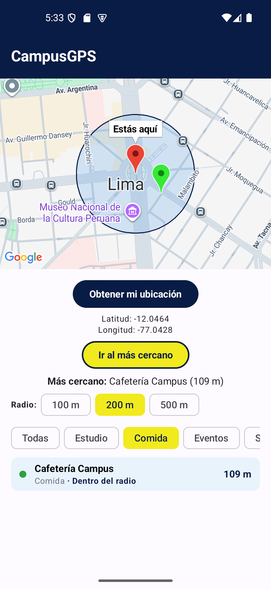
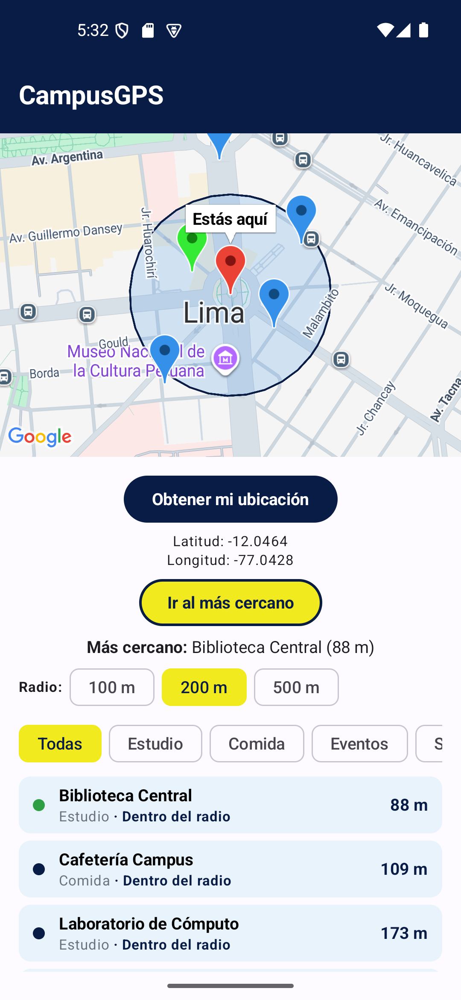
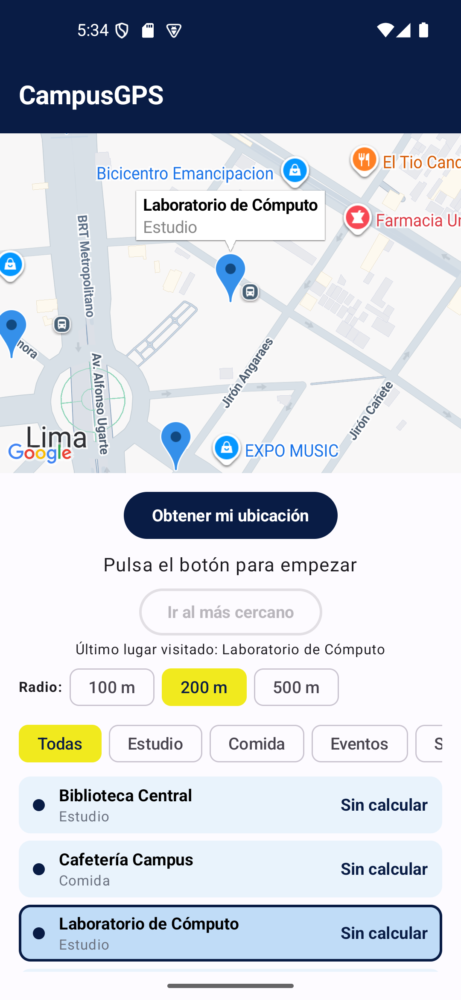

# CampusGPS — Cerron

Aplicación Android que obtiene la ubicación del celular, la muestra en un mapa e indica qué lugar del campus está más cerca. Presenta cinco puntos ficticios (biblioteca, cafetería, laboratorio, auditorio y estacionamiento) ordenados del más cercano al más lejano. También responde con un mensaje claro y una acción útil si se niega el permiso, si el GPS está apagado o si el dispositivo no tiene Google Play Services.

| Dato | Detalle |
|---|---|
| Paquete | `com.cerron.campusgps` |
| Tecnología | Kotlin, Jetpack Compose, Material 3, Google Play Services Location y Maps Compose |
| Arquitectura | MVVM + Repository |
| Paleta | Navy `#091C45` (primario), Glacier Blue `#62A7EA` y Lemon `#F1EA1E` |

## Cómo ejecutar

1. Abrir esta carpeta en Android Studio y sincronizar Gradle.
2. Copiar `local.properties.example` como `local.properties` y ajustar `sdk.dir`.
3. Crear una clave en Google Cloud con **Maps SDK for Android** habilitado. Restringirla al paquete `com.cerron.campusgps` y a la huella SHA-1 que muestra `gradlew signingReport`.
4. Guardar la clave solo en `local.properties`: `MAPS_API_KEY=...`.
5. Ejecutar en un emulador con Google Play. En **Extended controls → Location**, escribir `-12.0464` y `-77.0428` y pulsar **Set location**.

## Estructura de paquetes

```text
com.cerron.campusgps/
├── MainActivity.kt
├── model/
│   └── Modelos.kt
├── data/
│   ├── UbicacionRepository.kt
│   ├── UbicacionRepositoryGoogle.kt
│   ├── LugaresRepository.kt
│   ├── LugaresRepositoryLocal.kt
│   ├── UltimoLugarRepository.kt
│   └── UltimoLugarRepositoryDataStore.kt
├── util/
│   ├── Distancia.kt
│   ├── Formato.kt
│   └── Filtros.kt
├── viewmodel/
│   ├── MapaViewModel.kt
│   └── CampusViewModelFactory.kt
└── ui/
    ├── PantallaMapa.kt
    ├── MapaUbicacion.kt
    ├── ListaLugares.kt
    ├── MensajeError.kt
    ├── FiltroCategorias.kt
    ├── SelectorRadio.kt
    └── theme/
        └── Theme.kt
```

## Diagrama MVVM



`MainActivity` crea las dependencias con `CampusViewModelFactory`. El ViewModel solo conoce las interfaces y no recibe `Context`. Los Composables dibujan el estado y no calculan distancias.

## Capturas

| Permiso | Mapa con mi ubicación | Marcadores |
|---|---|---|
|  |  |  |

| Lista ordenada | Error |
|---|---|
|  |  |

## Pruebas de aceptación

| Prueba | Resultado esperado | OK |
|---|---|---|
| Abrir la app por primera vez y pulsar el botón | Aparece el cuadro de permiso | ✅ |
| Aceptar el permiso | Se ven latitud, longitud y el marcador Estás aquí | ✅ |
| Negar el permiso | Mensaje de error con Abrir ajustes; la app no se cierra | ✅ |
| Ubicación en el punto base | Los 5 lugares aparecen cerca de la posición | ✅ |
| Tocar un marcador | Se ve el nombre y la categoría del lugar | ✅ |
| Lista de lugares | Ordenada de menor a mayor distancia, con m o km | ✅ |
| Tocar una tarjeta de la lista | La cámara viaja a ese lugar y la tarjeta queda resaltada | ✅ |
| Ir al más cercano | La cámara va al lugar verde; el botón está deshabilitado antes de buscar | ✅ |
| Cambiar la ubicación del emulador y buscar otra vez | Se actualizan las distancias, el orden y el lugar verde | ✅ |
| Ubicación apagada | Mensaje de GPS con Reintentar | ✅ |
| Rotar la pantalla | No se pierden la ubicación ni la lista | ✅ |
| Revisar el repositorio | La clave no aparece y `local.properties` no está subido | ✅ |

## Fase 2: mejoras con IA

| Mejora | Qué hace | Capas que cambian |
|---|---|---|
| Filtrar por categoría | Chips que muestran solo los lugares de esa categoría en el mapa y en la lista | ViewModel + View |
| Radio de cercanía | Selector de 100, 200 o 500 m con un círculo en el mapa; la lista marca los lugares dentro del radio | ViewModel + View |
| Último lugar visitado | Guarda con DataStore el último lugar seleccionado y lo recupera al abrir la app | Repository + ViewModel + View |

| Filtro por categoría | Radio de cercanía | Último lugar visitado |
|---|---|---|
|  |  |  |

El detalle de los prompts y las decisiones está en [PROMPTS.md](PROMPTS.md).

## Para pensar

1. **¿Por qué `FusedLocationProviderClient` está dentro del Repository y no en el ViewModel?**
   Porque el Repository encapsula el proveedor y las dependencias de Android. El ViewModel trabaja con una interfaz, no necesita `Context` y se puede probar con un repositorio falso.

2. **¿Qué diferencia hay entre el permiso de ubicación y la clave de API de Maps? ¿Qué pasa si falta cada uno?**
   El permiso lo concede el usuario para acceder a la ubicación del dispositivo; la clave identifica a la app ante Google Maps. Sin permiso, la app muestra un error con **Abrir ajustes**. Sin una clave válida, el mapa no carga, pero la ubicación y las distancias siguen funcionando.

3. **¿Por qué la clave va en `local.properties` y no en el código? ¿Qué harías si se subiera a GitHub por error?**
   Porque ese archivo está en `.gitignore` y no se sube al repositorio. Si la clave se publicara, la eliminaría en Google Cloud, crearía una nueva y revisaría `.gitignore`; borrarla del último commit no basta porque sigue en el historial.

4. **¿Dónde calculas la distancia y por qué no en el Composable?**
   En `util/Distancia.kt`, y el ViewModel la usa en `actualizarDistancias` cuando llega la ubicación. Así no se repite el cálculo en cada recomposición y la lógica queda fuera de la vista.

5. **¿Qué pasa con tu app si el usuario niega el permiso dos veces? ¿Cómo lo manejas?**
   Android deja de mostrar el cuadro de permiso. La app no se cierra: muestra el mensaje de error y el botón **Abrir ajustes**, que lleva a la pantalla de la app para activar el permiso manualmente.
