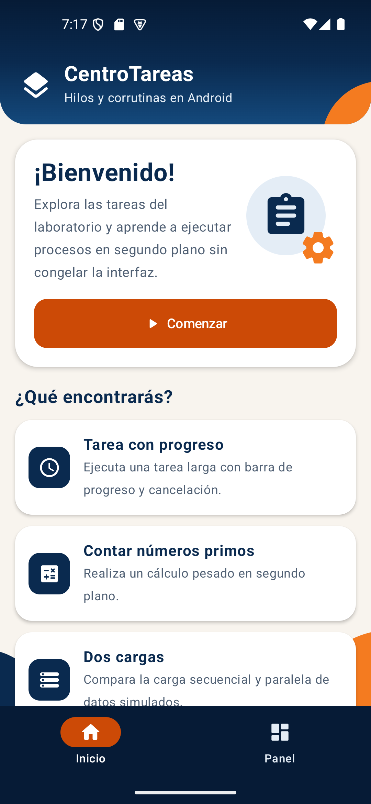
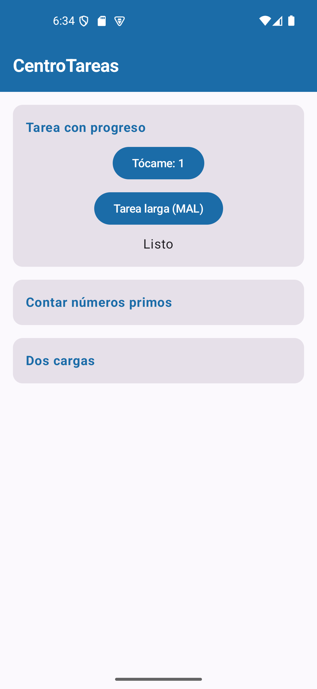
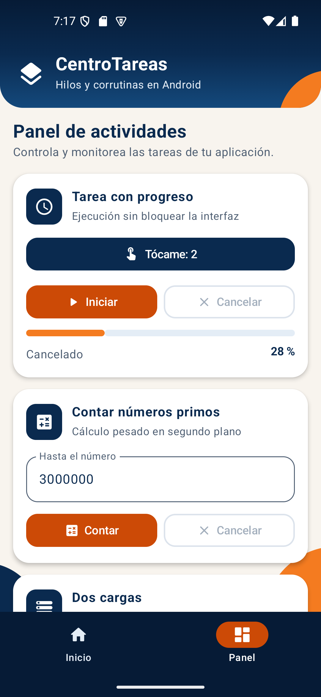
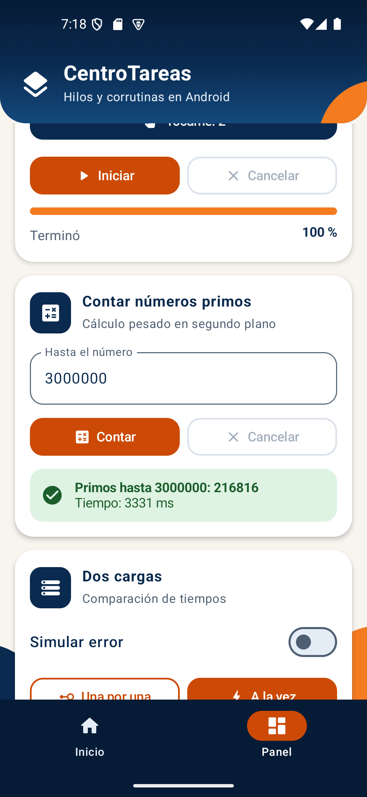
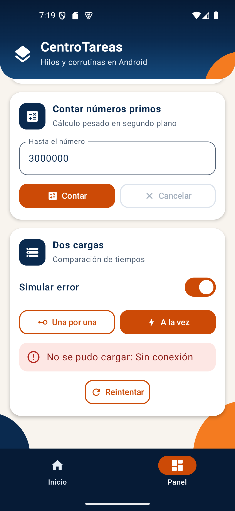
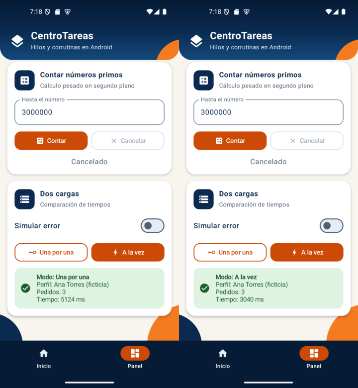
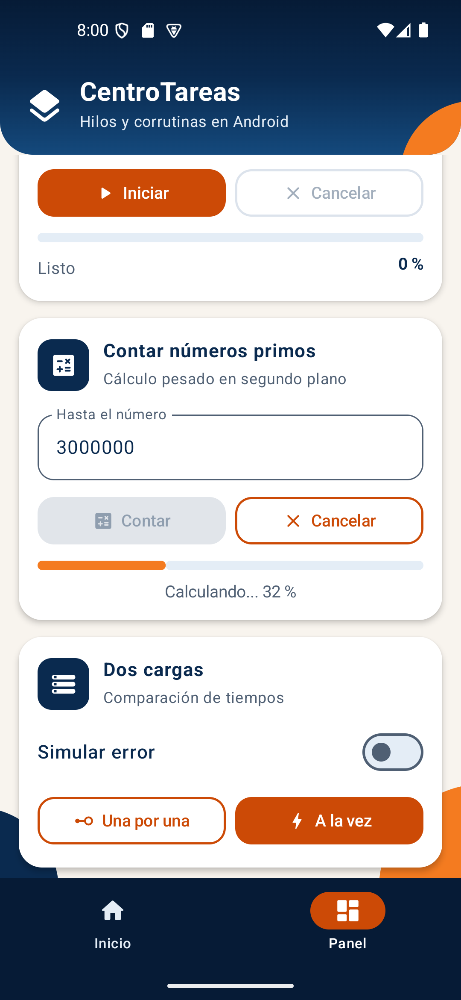
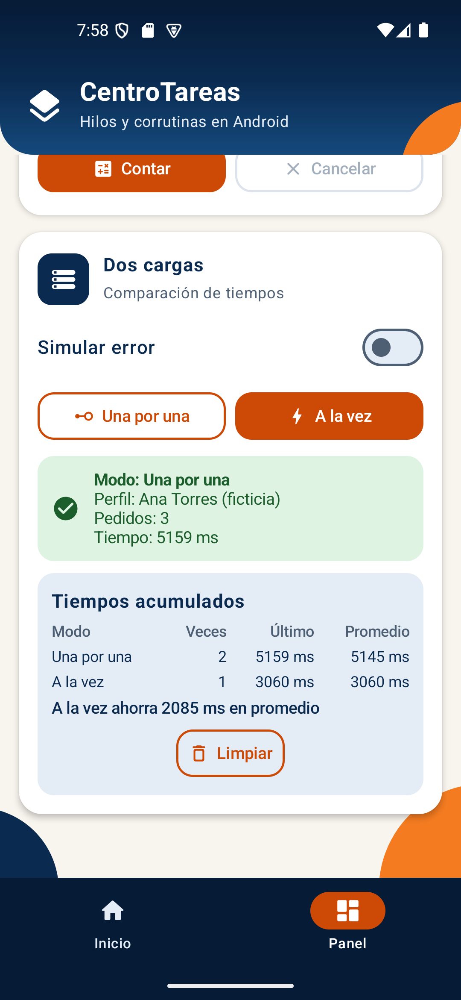

# CentroTareas

**Autor:** Fairus Cerron
**Curso:** Programación en Móviles · Semana 14 · Hilos en Android

## Descripción

CentroTareas es una app Android hecha con Kotlin, Jetpack Compose y Material 3. Ejecuta tres trabajos que tardan sin congelar la pantalla: una tarea con barra de progreso, un cálculo pesado (contar números primos) y dos cargas de datos simuladas. Usa corrutinas, `ViewModel` y `StateFlow`, permite cancelar las tareas largas y muestra los estados de carga, éxito y error. Todos los datos son ficticios.

## Árbol de paquetes

```text
com.cerron.centrotareas/
├── MainActivity.kt
├── model/
│   └── Estados.kt                  PrimosUi, CargaUi
├── data/
│   ├── TareasRepository.kt         interface
│   └── TareasRepositoryLocal.kt    cargas simuladas y contarPrimos
├── viewmodel/
│   ├── TareasViewModel.kt
│   └── TareasViewModelFactory.kt
└── ui/
    ├── PantallaTareas.kt           las tres tarjetas
    └── theme/
```

## Arquitectura MVVM + Repository

```text
View (PantallaTareas)
   |  eventos: botones              ^  collectAsState()
   v                                |
ViewModel (TareasViewModel)  --- StateFlow --->
   |  viewModelScope.launch { ... }
   v
TareasRepository (interface)  --->  TareasRepositoryLocal
                                    (cargas simuladas y contar primos)
```

## Observación del Paso 1

Al pulsar **Tarea larga (MAL)** la pantalla se queda congelada durante 4 segundos. El botón **Tócame** no suma mientras dura la espera, y el toque recién se procesa cuando el hilo principal se libera.

El texto **Trabajando...** no llega a verse porque `Thread.sleep(4000)` bloquea el hilo principal, que es el mismo que dibuja la pantalla. El mensaje cambia a `Trabajando...`, pero Compose no puede redibujar hasta que termine la espera, y para entonces el mensaje ya cambió a `Terminó`. En la captura tomada durante el bloqueo todavía se lee **Listo**.

Si la espera fuera de 10 segundos, creo que Android mostraría el diálogo **ANR (Application Not Responding)**, que avisa que la app no responde y ofrece cerrarla o esperar. Ese aviso aparece cuando la app no atiende un toque durante unos 5 segundos.

## Capturas

La app abre en una pantalla de bienvenida y las tareas están en la sección **Panel**. La captura del Paso 1 conserva la interfaz original, porque el código que congelaba la pantalla se reemplazó en el Paso 2.



| Pantalla congelada (Paso 1) | Tarea cancelada (Paso 4) |
| :---: | :---: |
|  |  |

| Primos (Paso 5) | Error simulado (Paso 7) |
| :---: | :---: |
|  |  |

**Una por una contra a la vez (Paso 6)**



## Pruebas de aceptación

Probadas en el emulador Pixel_5 con Android 15.

| Prueba | Resultado obtenido | OK |
| --- | --- | :---: |
| Tarea larga: tocar Tócame mientras trabaja | El contador siguió sumando | ☑ |
| Logcat con filtro HILO | `Antes: main`, `Dentro: DefaultDispatcher-worker-1`, `Despues: main` | ☑ |
| Iniciar la tarea con progreso | La barra llegó a 100 % en unos 4,5 s | ☑ |
| Cancelar a mitad | La barra se detuvo en 28 %, dice Cancelado y se puede iniciar otra vez | ☑ |
| Pulsar Iniciar dos veces seguidas | Se lanzó una sola tarea | ☑ |
| Primos hasta 1000 | 168 | ☑ |
| Primos con N grande | La pantalla respondió y Cancelar funcionó | ☑ |
| Una por una | 5124 ms, perfil y 3 pedidos | ☑ |
| A la vez | 3040 ms, perfil y 3 pedidos | ☑ |
| Error simulado + Reintentar | Recuadro de error; al desactivar el interruptor y reintentar, éxito | ☑ |
| Rotar la pantalla durante la tarea | La tarea continuó y el progreso no se reinició | ☑ |
| Revisar el código | No hay `GlobalScope`, `runBlocking` ni `Thread.sleep` | ☑ |

Comprobación del algoritmo de primos:

| N | 100 | 1000 | 10 000 | 100 000 | 500 000 |
| --- | ---: | ---: | ---: | ---: | ---: |
| Primos | 25 | 168 | 1229 | 9592 | 41 538 |

El valor por defecto del campo es **3 000 000**. En este emulador, 500 000 tardaba 616 ms y 3 000 000 tarda unos 3,3 s, dentro del rango de 2 a 5 s que pide la guía.

## Fase 2: mejoras

Las mejoras están en la rama `mejora-ia-semana14` y mantienen la arquitectura MVVM + Repository.

| Mejora | Qué logra | Capas que cambian |
| --- | --- | --- |
| Progreso desde el Repository | La tarea simulada pasa al Repository y expone su avance con `flow { emit(...) }` y `flowOn(Dispatchers.Default)` | Repository + ViewModel |
| Primos con progreso | Muestra una barra y el porcentaje del cálculo mientras avanza, y se puede cancelar | Repository + ViewModel + View |
| Comparación de tiempos | Acumula los tiempos de Una por una y A la vez, con veces, último, promedio y ahorro. Las cargas con error no se registran | ViewModel + View |

Al calcular el porcentaje, contar los primos hasta 3 000 000 tarda entre 4,3 y 5,7 s en el emulador.

| Primos con porcentaje | Tiempos acumulados |
| :---: | :---: |
|  |  |

## Para pensar

**1. ¿Por qué no se veía Trabajando... en el Paso 1?**
Porque `Thread.sleep` bloqueó el hilo principal justo después de cambiar el mensaje. Ese hilo es el que dibuja la pantalla, así que no hubo ningún redibujado hasta que terminó la espera, cuando el mensaje ya decía `Terminó`.

**2. ¿Qué diferencia hay entre Thread.sleep y delay?**
`Thread.sleep` bloquea el hilo: nadie más puede usarlo mientras espera. `delay` suspende solo la corrutina y libera el hilo para otros trabajos, como dibujar la pantalla. Además, `delay` responde a la cancelación.

**3. ¿Por qué Dispatchers.Default para los primos y Dispatchers.IO para la red?**
Contar primos usa el procesador todo el tiempo, y `Dispatchers.Default` tiene un grupo de hilos ajustado a la cantidad de núcleos. La red pasa casi todo el tiempo esperando una respuesta, y `Dispatchers.IO` permite muchos más hilos para que esas esperas no ocupen los hilos del cálculo.

**4. ¿Qué pasaría con la corrutina si el usuario cierra la pantalla? ¿Qué papel cumple viewModelScope?**
`viewModelScope` ata las corrutinas a la vida del ViewModel. Si el usuario cierra la pantalla definitivamente, el ViewModel se destruye y sus corrutinas se cancelan, lo que evita fugas y trabajo inútil. Si solo rota la pantalla, el ViewModel sobrevive y la tarea continúa sin reiniciarse.

**5. ¿Por qué async tarda 3 s y no 5 s? ¿Qué pasa si una de las dos cargas falla?**
Porque las dos cargas corren al mismo tiempo, así que el total lo marca la más lenta: máximo(2 s, 3 s) ≈ 3 s. Si una falla, `coroutineScope` cancela la otra y relanza la excepción. El `try/catch` del ViewModel la atrapa y muestra el estado de error sin cerrar la app.
