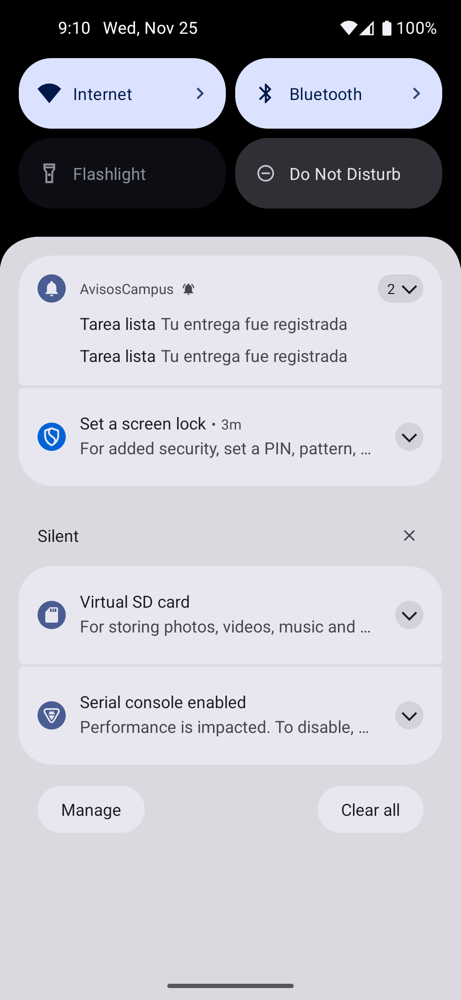
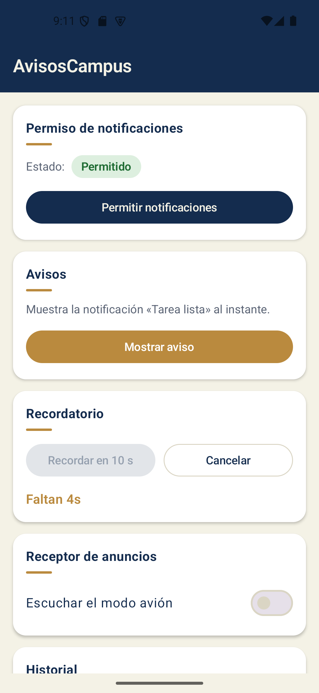
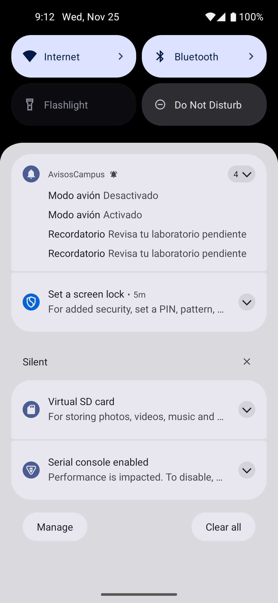
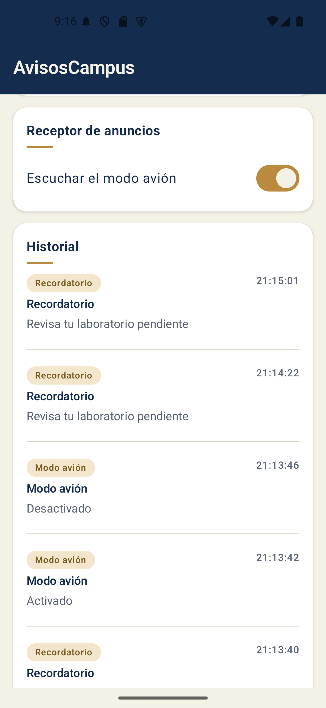
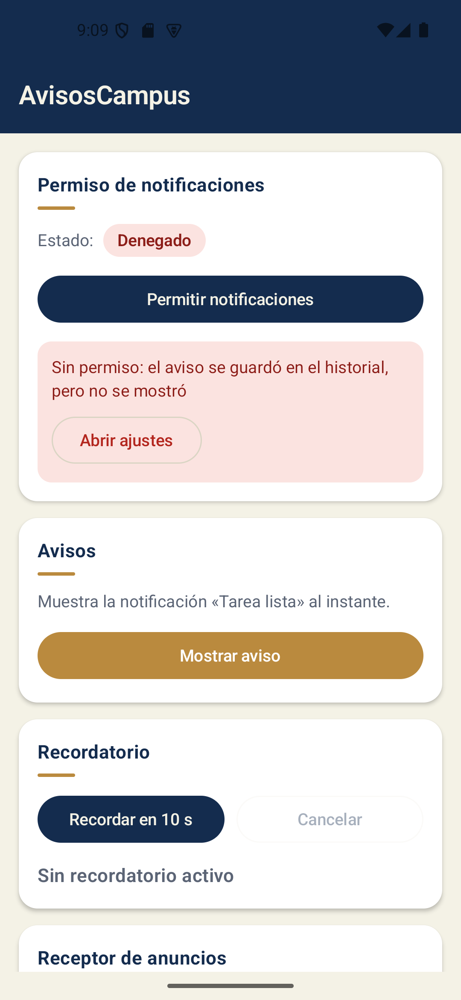

# AvisosCampus

App Android que **muestra notificaciones y escucha lo que pasa en el celular**. Con un botón muestra un aviso, con otro programa un recordatorio que llega a los 10 segundos y, si se activa el switch, avisa cuando el usuario activa o desactiva el modo avión. Todo queda anotado en un historial.

| Dato | Detalle |
|---|---|
| Curso | Programación en Móviles · Semana 15 |
| Tecnología | Kotlin + Jetpack Compose + Material 3 (sin XML), notificaciones locales y BroadcastReceiver |
| Patrón | MVVM + Repository (interface) |
| Datos | Solo ficticios, todo local (sin internet ni claves) |
| Probado en | Emulador Pixel 5 · Android 13+ (API 33+) |

## Funciones

- **Canal «Avisos»** creado una sola vez en la clase `Application`.
- **Permiso `POST_NOTIFICATIONS`** pedido en tiempo de ejecución, con su estado en pantalla: *Sin pedir*, *Permitido* o *Denegado*.
- **Mostrar aviso**: notificación «Tarea lista / Tu entrega fue registrada». Cada aviso usa su propio id, así que dos pulsaciones dan dos notificaciones.
- **Abrir la app** al tocar la notificación (`PendingIntent` inmutable + `setAutoCancel(true)`).
- **Recordatorio en 10 s** con cuenta regresiva (`Faltan Ns`) en una corrutina, que se puede cancelar.
- **Receptor del modo avión** (`BroadcastReceiver`) que se registra solo mientras el switch está activo y se quita en `onDispose`.
- **Historial** con los 20 avisos más recientes arriba: origen, título, texto y hora.
- **Permiso denegado**: el aviso se guarda en el historial, aparece un mensaje de error y el botón *Abrir ajustes*. La app nunca se cierra.

## Paleta de colores

| Color | Hex | Uso |
|---|---|---|
| Deep Navy | `#142C4E` | Barra superior, títulos de las tarjetas, botones principales |
| Soft Ivory | `#F4F2E6` | Fondo de la app y texto sobre la barra |
| Antique Gold | `#BA8A3E` | Botón *Mostrar aviso*, cuenta regresiva, switch y filete de las tarjetas |

## Estructura de paquetes

```
com.tecsup.avisoscampus/
├── AvisosApp.kt                 Application: crea el canal
├── MainActivity.kt
├── model/
│   └── Modelos.kt               Aviso, Origen, PermisoUi
├── data/
│   └── AvisosRepository.kt      interface + AvisosRepositoryMemoria
├── notificacion/
│   └── Notificador.kt           canal, permiso y mostrar
├── receiver/
│   └── ModoAvionReceiver.kt     escucha ACTION_AIRPLANE_MODE_CHANGED
├── viewmodel/
│   ├── AvisosViewModel.kt       permiso, aviso, recordatorio, modo avión, errores
│   └── AvisosViewModelFactory.kt
└── ui/
    ├── PantallaAvisos.kt        tarjetas, permiso, receptor y eventos
    ├── HistorialAvisos.kt       lista de avisos
    └── theme/                   Color.kt y Theme.kt (paleta)
```

## Arquitectura MVVM + Repository

```
View (PantallaAvisos)
   | eventos: botones, switch          ^ collectAsState()
   v                                   |
ViewModel (AvisosViewModel) --- StateFlow (avisos, permiso, faltan, escuchandoAvion, mensaje) --->
   | registra el aviso                 | emite: eventos (SharedFlow<Aviso>)
   v                                   v
AvisosRepository (interface)        View recibe el evento y llama a
 -> AvisosRepositoryMemoria          Notificador.mostrar(context, aviso)
```

| Capa | Conoce a | No debe |
|---|---|---|
| View (`ui/`) | Solo a su ViewModel y al Notificador | Decidir qué se avisa ni guardar el historial |
| ViewModel | Solo a la interface del Repository | Conocer Composables, recibir un Context ni mostrar notificaciones |
| Repository | Nada de la UI | Usar Context |
| Notificador | El sistema (canal, NotificationManager) | Guardar estado de la app |

En `viewmodel/` no hay `Context`, `NotificationManager` ni `BroadcastReceiver`. El ViewModel decide qué avisar, lo anota en el Repository y emite un evento; la pantalla, que sí tiene `Context`, llama al `Notificador`.

## Capturas

| Notificación en el panel | Recordatorio | Modo avión |
|---|---|---|
|  |  |  |

| Historial | Permiso denegado |
|---|---|
|  |  |

## Pruebas de aceptación (emulador Android 13+)

| Prueba | Resultado esperado | OK |
|---|---|---|
| Abrir Ajustes → Apps → AvisosCampus → Notificaciones | Existe el canal **Avisos** | ✅ |
| Pulsar **Permitir notificaciones** | Aparece el cuadro de Android y la etiqueta cambia | ✅ |
| Pulsar **Mostrar aviso** | Aparece la notificación **Tarea lista** | ✅ |
| Pulsar **Mostrar aviso** dos veces | Aparecen dos notificaciones distintas | ✅ |
| Tocar la notificación | Se abre la app y la notificación desaparece | ✅ |
| Recordar en 10 s | Cuenta regresiva y aviso al llegar a 0 | ✅ |
| Recordar y minimizar la app | El aviso llega igual | ✅ |
| Recordar y cancelar | No llega ningún aviso | ✅ |
| Switch activado y cambiar el modo avión | Aviso **Activado** y luego **Desactivado** | ✅ |
| Switch desactivado y cambiar el modo avión | No hay aviso | ✅ |
| Permiso denegado y **Mostrar aviso** | Mensaje de error, aviso en el historial y la app no se cierra | ✅ |
| Rotar la pantalla durante el recordatorio | La cuenta regresiva continúa | ✅ |
| Revisar el código | No hay Context en `viewmodel/` y todo receptor registrado se quita en `onDispose` | ✅ |

## Para pensar

**1. ¿Por qué una notificación necesita un canal y un permiso? ¿Qué pasa si falta cada uno?**
El **canal** (Android 8+) agrupa las notificaciones por tipo y define su importancia, sonido y vibración; además le permite al usuario apagar solo ese tipo de avisos desde Ajustes. Si falta el canal, en Android 8+ la notificación no se muestra (el sistema la descarta y solo deja un aviso en el Logcat). El **permiso** `POST_NOTIFICATIONS` (Android 13+) es la decisión del usuario de dejar que la app le escriba; si falta, `notify` no muestra nada. Por eso `Notificador.mostrar` revisa el permiso antes y devuelve `false`, y la app avisa con un mensaje en lugar de fallar en silencio.

**2. ¿Por qué el ViewModel emite un evento y no muestra la notificación él mismo?**
Mostrar una notificación necesita un `Context`, y el ViewModel vive más que la Activity: si guardara un `Context` podría filtrar memoria al rotar la pantalla. Además, sin `Context` el ViewModel se puede probar sin Android. El ViewModel decide **qué** avisar y lo registra en el Repository; la pantalla recibe el evento por el `SharedFlow` y decide **cómo** mostrarlo con el `Notificador`. Se usa un `SharedFlow` y no un `StateFlow` porque es un evento de una sola vez: no debe repetirse al rotar.

**3. ¿Qué pasa si usas el mismo id en dos notificaciones?**
La segunda **reemplaza** a la primera: en el panel queda una sola. Por eso se usa `aviso.id`, que el Repository incrementa en cada registro, y al pulsar dos veces aparecen dos notificaciones distintas. Reusar el id solo conviene cuando se quiere actualizar el mismo aviso (por ejemplo, una barra de progreso).

**4. ¿Por qué `onReceive` debe ser corto y por qué hay que quitar el receptor al salir?**
`onReceive` corre en el **hilo principal**: si hace trabajo largo congela la interfaz y, pasados unos segundos, Android puede mostrar un ANR. Por eso el receptor solo lee el extra `state` y entrega el valor; el ViewModel hace el resto. Hay que quitar el receptor con `unregisterReceiver` en `onDispose` porque un receptor registrado guarda una referencia a la pantalla: si no se quita, **se filtra memoria** y sigue recibiendo anuncios aunque la pantalla ya no exista (Android solo avisa con un log de *leaked receiver*).

**5. ¿En qué casos usarías una notificación local y en cuáles una push de Firebase?**
**Local** cuando el aviso nace en el propio celular y la app ya sabe cuándo darlo: un recordatorio programado, un temporizador, el fin de una descarga o un cambio del sistema como el modo avión. No necesita internet ni servidor. **Push (Firebase Cloud Messaging)** cuando el aviso nace fuera del celular: un mensaje nuevo de otro usuario, una nota publicada por el docente o una oferta enviada desde el servidor, incluso con la app cerrada. Llega por internet y requiere un backend o la consola de Firebase.
